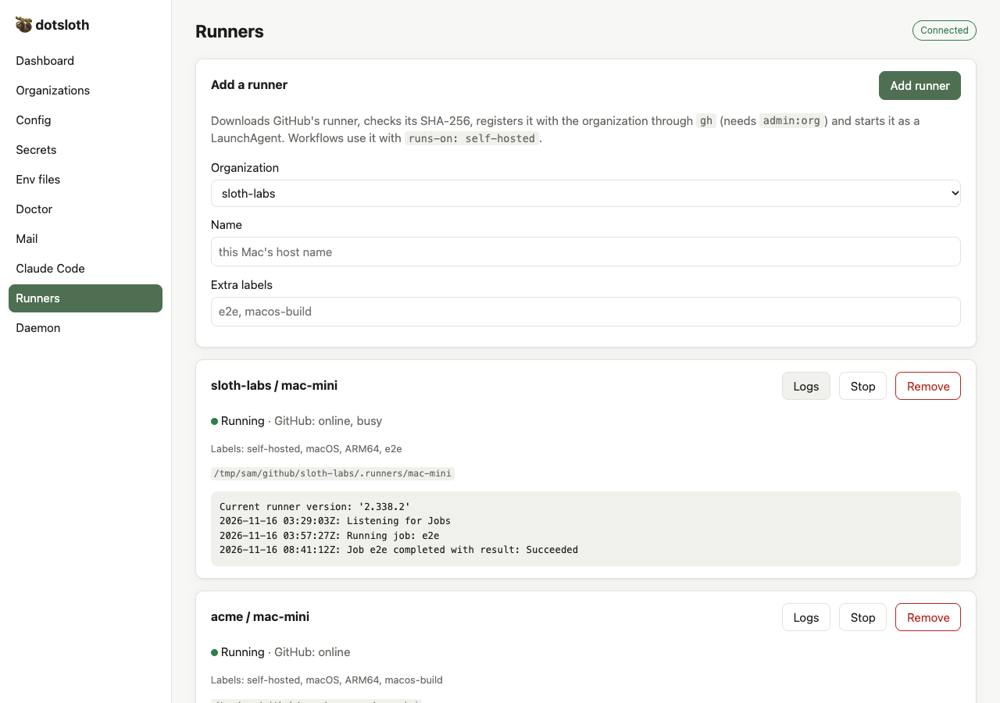
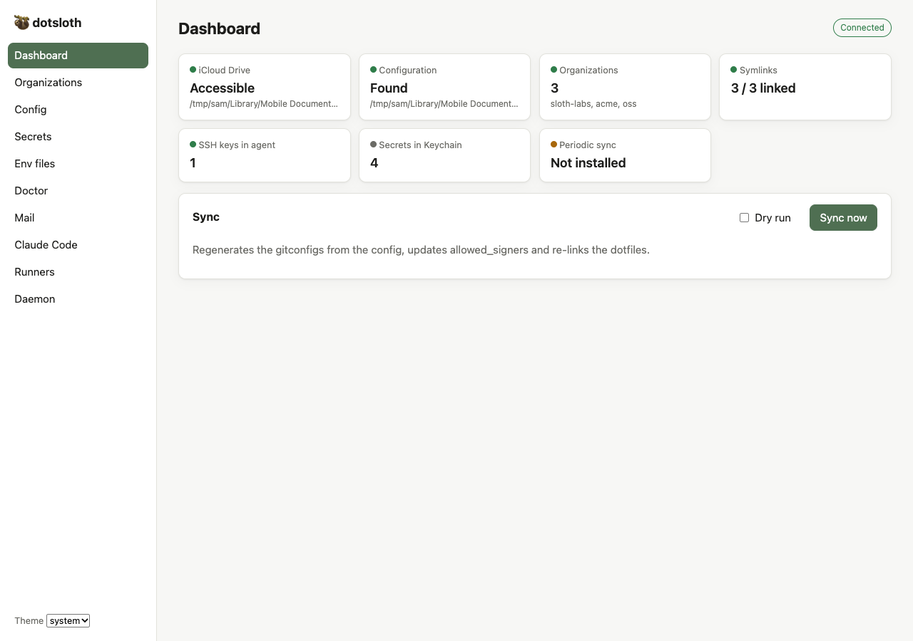
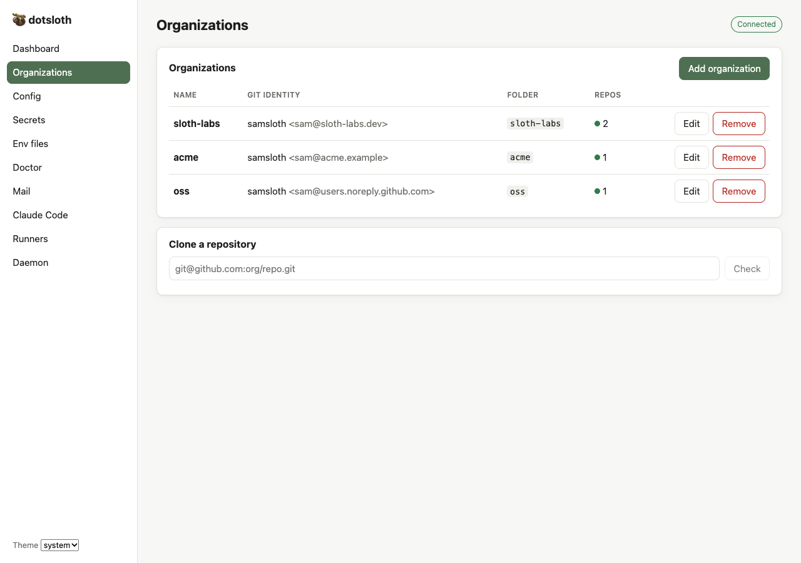
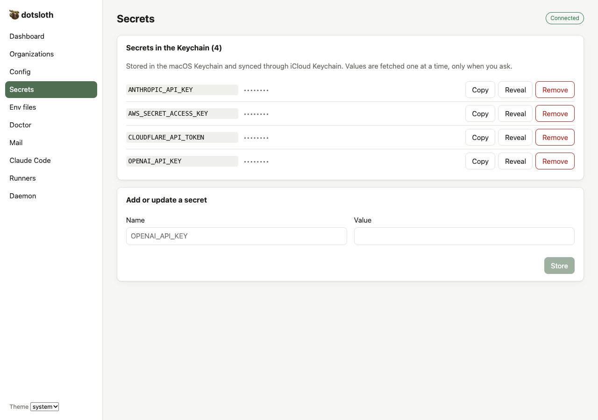
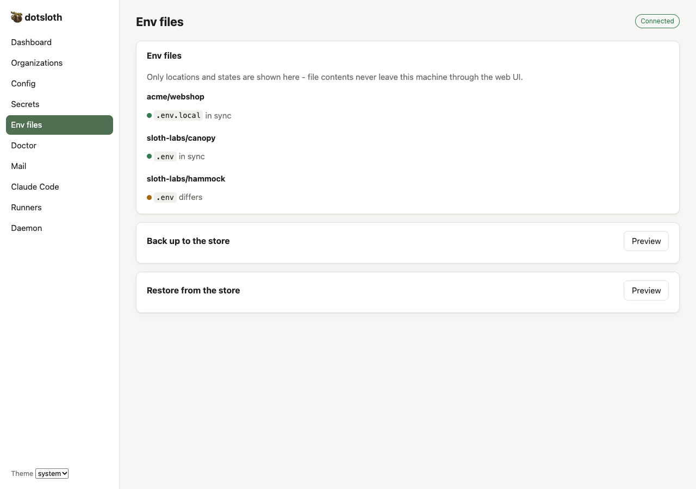

# dotsloth

**Sync your dots, be a sloth.** A macOS CLI that keeps your development
environment — git identities, dotfiles, secrets, env files and Claude Code
config — in sync across machines via iCloud Drive and the macOS Keychain.

[](https://www.npmjs.com/package/@phibar/dotsloth)
[](https://www.npmjs.com/package/@phibar/dotsloth)
[](https://github.com/phibar/dotsloth/actions/workflows/release.yml)
[](https://nodejs.org)
[](./LICENSE)
[](https://oclif.io)

## What it does

- **Git identities per organization.** Generates `~/.gitconfig` with `includeIf`
  rules so repos under `~/github/<org>/` automatically use the right name, email
  and signing key. Every command that changes config re-applies it immediately.
- **Dotfiles via iCloud.** `~/.gitconfig`, `~/.zprofile` and `~/.ssh/config` are
  symlinked to versions stored in iCloud Drive.
- **Secrets in the Keychain.** Sensitive exports are pulled out of shell
  profiles and stored encrypted, never in a synced plaintext file.
- **Env files.** `.env` and friends are gitignored by design, so git never saves
  them. `dotsloth env` backs them up and restores them after a reinstall.
- **Claude Code.** Share `settings.json`, project memory and conversation
  history between machines.
- **Mail.** Back up Mail rules and signatures and recreate them on a new
  machine, with a checklist for the accounts that need a manual sign-in.
- **Pre-reinstall safety.** `dotsloth doctor` refuses to say "safe to wipe"
  while anything would be lost.
- **Self-hosted runners.** `dotsloth runner` runs your organizations' GitHub
  Actions jobs on this Mac — long e2e suites and macOS builds without spending
  hosted minutes.
- **Topics.** `dotsloth topics` links every cloned repo into
  `~/github/topics/<topic>/` by its GitHub topics.
- **Worktrees per issue.** `dotsloth worktree new 42` opens a git worktree on a
  branch named after issue #42; `worktree clean` removes the merged ones.
- **Periodic sync.** A launchd agent keeps everything current.
- **Web UI.** `dotsloth ui` opens a local web interface for all of the above.
- **Updates.** `dotsloth update` installs the latest release; every command
  and the web UI mention when one is out.

## Quick start

```sh
npm install -g @phibar/dotsloth
dotsloth init
dotsloth org add phibar --email you@phibar.work --username phibar
dotsloth clone git@github.com:phibar/some-repo.git
```

## Self-hosted runners

```sh
dotsloth runner add metatrom-ag                 # named after this Mac
dotsloth runner add metatrom-ag --labels e2e    # extra labels for runs-on
dotsloth runner list
dotsloth runner logs metatrom-ag
dotsloth runner remove metatrom-ag
```

`add` downloads GitHub's latest runner, checks its SHA-256 against the release
notes, registers it with the organization and starts it as a LaunchAgent. A
workflow uses it with `runs-on: self-hosted` (or `[self-hosted, e2e]`).

- Needs `gh` signed in with the `admin:org` scope; tokens are fetched for each
  add and remove and never stored.
- Organizations only — a personal account cannot hold organization runners.
- A runner lives in `~/github/<org>/.runners/<name>/`. That folder and its
  LaunchAgent are its whole record, so each Mac manages the runners it set up.
- A LaunchAgent runs while you are logged in: on an always-on Mac, turn on
  automatic login so the runners come back after a restart.
- The runner updates itself.

The **Runners** page of `dotsloth ui` does the same, with the runner's log:



## Web UI

```sh
dotsloth ui
```

Starts a local server, prints a sign-in link and opens it in your browser.
Everything the CLI does is there: a dashboard with sync, organizations and
cloning, a config editor, secrets, env files, doctor, Mail, Claude Code,
self-hosted runners and the periodic sync. A banner says when a newer version
is out. Press Ctrl+C to stop it.



<details><summary>More screenshots</summary>





</details>

| Flag         |                                              |
| ------------ | -------------------------------------------- |
| `--port <n>` | Listen on a fixed port (default: a free one) |
| `--no-open`  | Print the link without opening the browser   |

**Security model.** The server can reach your Keychain, config and every
repository, so it only answers the browser tab it opened:

- It listens on `127.0.0.1` only.
- The printed link carries a random token. Opening it swaps the token for an
  HttpOnly, SameSite=Strict session cookie and removes it from the address
  bar; every other request needs that cookie. The link stays valid while this
  `dotsloth ui` runs (so you can sign in again after closing the browser) -
  treat it like a password, and stop the server when you are done.
- Requests with a foreign `Host` (DNS rebinding) or, for anything that
  changes state, a foreign `Origin` (CSRF) are refused.
- Secret values are fetched one at a time when you click Reveal or Copy;
  there is no way to read several at once. Env file contents are never sent.
- Deleting an organization's repositories requires typing its name, and the
  server checks it again.
- Mail is only contacted when you ask: it is driven via AppleScript, and
  macOS asks once for permission to control it.

## Reinstalling your Mac

See **[BOOTSTRAP.md](./BOOTSTRAP.md)** for the full ordered procedure. The short
version — before you wipe:

```sh
dotsloth doctor          # exits non-zero while anything would be lost
dotsloth env push
dotsloth claude memory push
brctl log --wait --shorten   # a file in iCloud is not a backup until uploaded
```

And on the new machine: Homebrew → node → iCloud sign-in → dotsloth → SSH key →
`dotsloth sync` → clone → `dotsloth env pull`.

## Where things live

| What           | Where                                                                             |
| -------------- | --------------------------------------------------------------------------------- |
| Config         | `~/Library/Mobile Documents/com~apple~CloudDocs/development/dotsloth/config.json` |
| Dotfiles       | `.../development/dotsloth/dotfiles/`                                              |
| Org gitconfigs | `.../development/dotsloth/organizations/`                                         |
| Env files      | `.../development/dotsloth/envs/<org>/<repo>/`                                     |
| Claude Code    | `.../development/dotsloth/claude/`                                                |
| Secrets        | macOS Keychain, account `dotsloth`                                                |
| Repos          | `~/github/<org>/<repo>`                                                           |
| Runners        | `~/github/<org>/.runners/<name>/`, LaunchAgent `actions.runner.<org>.<name>`      |
| Topic links    | `~/github/topics/<topic>/<repo>`                                                  |
| Local state    | `~/.config/dotsloth/state.json` (this Mac only: the update check)                 |

## Development

```sh
npm install
npm run build     # CLI (tsc) and web app (vite) into dist/
npm test          # mocha + vitest + biome
./bin/run.js <command>
```

Working on the web app with hot reload:

```sh
npm run dev:ui
```

It starts `dotsloth ui` from source, then Vite with the server's sign-in link
(so `/api` is proxied with the session cookie), and opens
http://localhost:5173. Ctrl+C stops both. `npm run dev:web` starts only Vite;
it reads the link from `DOTSLOTH_UI_URL`.

The code is layered so the CLI and the web UI share one implementation:
`src/core` holds the logic (typed results, no prompts or printing),
`src/commands` and `src/cli` are the terminal front end, `src/server` is the
web API, and `web/` is the React app.

<!-- toc -->
* [dotsloth](#dotsloth)
* [Usage](#usage)
* [Commands](#commands)
<!-- tocstop -->
# Usage

<!-- usage -->
```sh-session
$ npm install -g @phibar/dotsloth
$ dotsloth COMMAND
running command...
$ dotsloth (--version)
@phibar/dotsloth/0.11.6 linux-x64 node-v26.13.1
$ dotsloth --help [COMMAND]
USAGE
  $ dotsloth COMMAND
...
```
<!-- usagestop -->
# Commands

<!-- commands -->
* [`dotsloth claude history [DIRECTION]`](#dotsloth-claude-history-direction)
* [`dotsloth claude link`](#dotsloth-claude-link)
* [`dotsloth claude memory [DIRECTION]`](#dotsloth-claude-memory-direction)
* [`dotsloth claude status`](#dotsloth-claude-status)
* [`dotsloth clone SOURCE`](#dotsloth-clone-source)
* [`dotsloth daemon install`](#dotsloth-daemon-install)
* [`dotsloth daemon status`](#dotsloth-daemon-status)
* [`dotsloth daemon uninstall`](#dotsloth-daemon-uninstall)
* [`dotsloth doctor`](#dotsloth-doctor)
* [`dotsloth env list`](#dotsloth-env-list)
* [`dotsloth env pull`](#dotsloth-env-pull)
* [`dotsloth env push`](#dotsloth-env-push)
* [`dotsloth help [COMMAND]`](#dotsloth-help-command)
* [`dotsloth init`](#dotsloth-init)
* [`dotsloth mail export`](#dotsloth-mail-export)
* [`dotsloth mail restore`](#dotsloth-mail-restore)
* [`dotsloth mail status`](#dotsloth-mail-status)
* [`dotsloth org add [NAME]`](#dotsloth-org-add-name)
* [`dotsloth org list`](#dotsloth-org-list)
* [`dotsloth org remove NAME`](#dotsloth-org-remove-name)
* [`dotsloth org update [NAME]`](#dotsloth-org-update-name)
* [`dotsloth runner add ORG`](#dotsloth-runner-add-org)
* [`dotsloth runner list`](#dotsloth-runner-list)
* [`dotsloth runner logs ORG [NAME]`](#dotsloth-runner-logs-org-name)
* [`dotsloth runner remove ORG [NAME]`](#dotsloth-runner-remove-org-name)
* [`dotsloth runner start ORG [NAME]`](#dotsloth-runner-start-org-name)
* [`dotsloth runner stop ORG [NAME]`](#dotsloth-runner-stop-org-name)
* [`dotsloth secret add NAME`](#dotsloth-secret-add-name)
* [`dotsloth secret export`](#dotsloth-secret-export)
* [`dotsloth secret get NAME`](#dotsloth-secret-get-name)
* [`dotsloth secret list`](#dotsloth-secret-list)
* [`dotsloth secret load`](#dotsloth-secret-load)
* [`dotsloth secret remove NAME`](#dotsloth-secret-remove-name)
* [`dotsloth status`](#dotsloth-status)
* [`dotsloth sync`](#dotsloth-sync)
* [`dotsloth topics`](#dotsloth-topics)
* [`dotsloth ui`](#dotsloth-ui)
* [`dotsloth update`](#dotsloth-update)
* [`dotsloth worktree clean`](#dotsloth-worktree-clean)
* [`dotsloth worktree list`](#dotsloth-worktree-list)
* [`dotsloth worktree new ISSUE`](#dotsloth-worktree-new-issue)

## `dotsloth claude history [DIRECTION]`

Share Claude Code conversation history between machines

```
USAGE
  $ dotsloth claude history [DIRECTION] [--dry-run] [--retention <value>]

ARGUMENTS
  [DIRECTION]  (status|push|pull) [default: status] status | push | pull

FLAGS
  --dry-run            Show what would change without writing
  --retention=<value>  [default: 90] Only sync sessions touched within this many days

DESCRIPTION
  Share Claude Code conversation history between machines

EXAMPLES
  $ dotsloth claude history

  $ dotsloth claude history push

  $ dotsloth claude history pull --retention 30
```

_See code: [src/commands/claude/history.ts](https://github.com/phibar/dotsloth/blob/v0.11.6/src/commands/claude/history.ts)_

## `dotsloth claude link`

Share Claude Code settings between machines via the dotsloth store

```
USAGE
  $ dotsloth claude link [--dry-run]

FLAGS
  --dry-run  Show what would change without writing

DESCRIPTION
  Share Claude Code settings between machines via the dotsloth store

EXAMPLES
  $ dotsloth claude link

  $ dotsloth claude link --dry-run
```

_See code: [src/commands/claude/link.ts](https://github.com/phibar/dotsloth/blob/v0.11.6/src/commands/claude/link.ts)_

## `dotsloth claude memory [DIRECTION]`

Share Claude Code project memory between machines

```
USAGE
  $ dotsloth claude memory [DIRECTION] [--dry-run]

ARGUMENTS
  [DIRECTION]  (status|push|pull) [default: status] status | push | pull

FLAGS
  --dry-run  Show what would change without writing

DESCRIPTION
  Share Claude Code project memory between machines

EXAMPLES
  $ dotsloth claude memory

  $ dotsloth claude memory push

  $ dotsloth claude memory pull
```

_See code: [src/commands/claude/memory.ts](https://github.com/phibar/dotsloth/blob/v0.11.6/src/commands/claude/memory.ts)_

## `dotsloth claude status`

Show which Claude Code config is shared between machines

```
USAGE
  $ dotsloth claude status

DESCRIPTION
  Show which Claude Code config is shared between machines

EXAMPLES
  $ dotsloth claude status
```

_See code: [src/commands/claude/status.ts](https://github.com/phibar/dotsloth/blob/v0.11.6/src/commands/claude/status.ts)_

## `dotsloth clone SOURCE`

Clone a repository, or an organisation's repositories (optionally by topic), to the correct organization folder

```
USAGE
  $ dotsloth clone SOURCE [--dry-run] [--include-archived] [--include-forks] [-o <value>] [-t <value>...]
    [-y]

ARGUMENTS
  SOURCE  Repository URL, or an organisation to clone the repositories of

FLAGS
  -o, --org=<value>       Override organization (use a different org than detected)
  -t, --topic=<value>...  Organisation: only repositories with this topic (repeat for any of several)
  -y, --yes               Organisation: clone every matching repository without asking
      --dry-run           Organisation: list the matching repositories, clone nothing
      --include-archived  Organisation: clone archived repositories too
      --include-forks     Organisation: clone forks too

DESCRIPTION
  Clone a repository, or an organisation's repositories (optionally by topic), to the correct organization folder

EXAMPLES
  $ dotsloth clone git@github.com:phibar/some-repo.git

  $ dotsloth clone https://github.com/ipfs/kubo

  $ dotsloth clone git@github.com:fork/repo.git --org phibar

  $ dotsloth clone metatrom-ag --topic 0field

  $ dotsloth clone metatrom-ag -t 0field -t kernel --dry-run
```

_See code: [src/commands/clone.ts](https://github.com/phibar/dotsloth/blob/v0.11.6/src/commands/clone.ts)_

## `dotsloth daemon install`

Install the periodic sync agent (runs dotsloth sync on a schedule)

```
USAGE
  $ dotsloth daemon install [--interval <value>]

FLAGS
  --interval=<value>  [default: 86400] Seconds between syncs (default: once a day)

DESCRIPTION
  Install the periodic sync agent (runs dotsloth sync on a schedule)

EXAMPLES
  $ dotsloth daemon install

  $ dotsloth daemon install --interval 3600
```

_See code: [src/commands/daemon/install.ts](https://github.com/phibar/dotsloth/blob/v0.11.6/src/commands/daemon/install.ts)_

## `dotsloth daemon status`

Show whether periodic sync is installed and when it last ran

```
USAGE
  $ dotsloth daemon status

DESCRIPTION
  Show whether periodic sync is installed and when it last ran

EXAMPLES
  $ dotsloth daemon status
```

_See code: [src/commands/daemon/status.ts](https://github.com/phibar/dotsloth/blob/v0.11.6/src/commands/daemon/status.ts)_

## `dotsloth daemon uninstall`

Remove the periodic sync agent

```
USAGE
  $ dotsloth daemon uninstall

DESCRIPTION
  Remove the periodic sync agent

EXAMPLES
  $ dotsloth daemon uninstall
```

_See code: [src/commands/daemon/uninstall.ts](https://github.com/phibar/dotsloth/blob/v0.11.6/src/commands/daemon/uninstall.ts)_

## `dotsloth doctor`

Check whether anything would be lost if this machine were wiped

```
USAGE
  $ dotsloth doctor [--offline]

FLAGS
  --offline  Skip GitHub PR lookups (faster, less precise)

DESCRIPTION
  Check whether anything would be lost if this machine were wiped

EXAMPLES
  $ dotsloth doctor

  $ dotsloth doctor --offline
```

_See code: [src/commands/doctor.ts](https://github.com/phibar/dotsloth/blob/v0.11.6/src/commands/doctor.ts)_

## `dotsloth env list`

List env files found in your repos and whether they are backed up

```
USAGE
  $ dotsloth env list [--unsaved]

FLAGS
  --unsaved  Only show files that are not yet backed up

DESCRIPTION
  List env files found in your repos and whether they are backed up

EXAMPLES
  $ dotsloth env list

  $ dotsloth env list --unsaved
```

_See code: [src/commands/env/list.ts](https://github.com/phibar/dotsloth/blob/v0.11.6/src/commands/env/list.ts)_

## `dotsloth env pull`

Restore env files from the dotsloth store into your repos

```
USAGE
  $ dotsloth env pull [--dry-run] [-f]

FLAGS
  -f, --force    Overwrite local files that differ
      --dry-run  Show what would be restored without writing

DESCRIPTION
  Restore env files from the dotsloth store into your repos

EXAMPLES
  $ dotsloth env pull

  $ dotsloth env pull --force
```

_See code: [src/commands/env/pull.ts](https://github.com/phibar/dotsloth/blob/v0.11.6/src/commands/env/pull.ts)_

## `dotsloth env push`

Copy env files from your repos into the dotsloth store

```
USAGE
  $ dotsloth env push [--dry-run] [-f]

FLAGS
  -f, --force    Overwrite store entries that differ
      --dry-run  Show what would be copied without writing

DESCRIPTION
  Copy env files from your repos into the dotsloth store

EXAMPLES
  $ dotsloth env push

  $ dotsloth env push --dry-run
```

_See code: [src/commands/env/push.ts](https://github.com/phibar/dotsloth/blob/v0.11.6/src/commands/env/push.ts)_

## `dotsloth help [COMMAND]`

Display help for dotsloth.

```
USAGE
  $ dotsloth help [COMMAND...] [-n]

ARGUMENTS
  [COMMAND...]  Command to show help for.

FLAGS
  -n, --nested-commands  Include all nested commands in the output.

DESCRIPTION
  Display help for dotsloth.
```

_See code: [@oclif/plugin-help](https://github.com/oclif/plugin-help/blob/7.0.10/src/commands/help.ts)_

## `dotsloth init`

Initialize dotsloth on this machine

```
USAGE
  $ dotsloth init [-f] [--skip-secrets] [--skip-ssh]

FLAGS
  -f, --force         Overwrite existing configuration
      --skip-secrets  Skip secrets extraction from zprofile
      --skip-ssh      Skip SSH keychain setup

DESCRIPTION
  Initialize dotsloth on this machine

EXAMPLES
  $ dotsloth init
```

_See code: [src/commands/init.ts](https://github.com/phibar/dotsloth/blob/v0.11.6/src/commands/init.ts)_

## `dotsloth mail export`

Export Mail accounts, rules and signatures to the dotsloth store

```
USAGE
  $ dotsloth mail export [--dry-run]

FLAGS
  --dry-run  Show what would be exported without writing

DESCRIPTION
  Export Mail accounts, rules and signatures to the dotsloth store

EXAMPLES
  $ dotsloth mail export

  $ dotsloth mail export --dry-run
```

_See code: [src/commands/mail/export.ts](https://github.com/phibar/dotsloth/blob/v0.11.6/src/commands/mail/export.ts)_

## `dotsloth mail restore`

Recreate Mail signatures and rules, and list the accounts to re-add

```
USAGE
  $ dotsloth mail restore [--accounts-only] [--dry-run]

FLAGS
  --accounts-only  Only print the account checklist
  --dry-run        Show what would be recreated without changing Mail

DESCRIPTION
  Recreate Mail signatures and rules, and list the accounts to re-add

EXAMPLES
  $ dotsloth mail restore

  $ dotsloth mail restore --dry-run
```

_See code: [src/commands/mail/restore.ts](https://github.com/phibar/dotsloth/blob/v0.11.6/src/commands/mail/restore.ts)_

## `dotsloth mail status`

Compare Mail on this machine with what is in the dotsloth store

```
USAGE
  $ dotsloth mail status

DESCRIPTION
  Compare Mail on this machine with what is in the dotsloth store

EXAMPLES
  $ dotsloth mail status
```

_See code: [src/commands/mail/status.ts](https://github.com/phibar/dotsloth/blob/v0.11.6/src/commands/mail/status.ts)_

## `dotsloth org add [NAME]`

Add a new organization configuration

```
USAGE
  $ dotsloth org add [NAME] [-e <value>] [-u <value>]

ARGUMENTS
  [NAME]  Organization name (e.g., phibar)

FLAGS
  -e, --email=<value>     Git email for this organization
  -u, --username=<value>  Git username for this organization

DESCRIPTION
  Add a new organization configuration

EXAMPLES
  $ dotsloth org add

  $ dotsloth org add phibar --email you@phibar.work --username phibar
```

_See code: [src/commands/org/add.ts](https://github.com/phibar/dotsloth/blob/v0.11.6/src/commands/org/add.ts)_

## `dotsloth org list`

List configured organizations

```
USAGE
  $ dotsloth org list [--json]

FLAGS
  --json  Output as JSON

DESCRIPTION
  List configured organizations

EXAMPLES
  $ dotsloth org list
```

_See code: [src/commands/org/list.ts](https://github.com/phibar/dotsloth/blob/v0.11.6/src/commands/org/list.ts)_

## `dotsloth org remove NAME`

Remove an organization configuration

```
USAGE
  $ dotsloth org remove NAME [--delete-repos] [-f]

ARGUMENTS
  NAME  Organization name to remove

FLAGS
  -f, --force         Skip confirmation
      --delete-repos  Also delete the repository folder

DESCRIPTION
  Remove an organization configuration

EXAMPLES
  $ dotsloth org remove phibar
```

_See code: [src/commands/org/remove.ts](https://github.com/phibar/dotsloth/blob/v0.11.6/src/commands/org/remove.ts)_

## `dotsloth org update [NAME]`

Update an organization configuration

```
USAGE
  $ dotsloth org update [NAME] [-e <value>] [-u <value>]

ARGUMENTS
  [NAME]  Organization name to update

FLAGS
  -e, --email=<value>     New git email
  -u, --username=<value>  New git username

DESCRIPTION
  Update an organization configuration

EXAMPLES
  $ dotsloth org update

  $ dotsloth org update phibar

  $ dotsloth org update phibar --email new@email.com
```

_See code: [src/commands/org/update.ts](https://github.com/phibar/dotsloth/blob/v0.11.6/src/commands/org/update.ts)_

## `dotsloth runner add ORG`

Download, register and start a self-hosted GitHub Actions runner for an organization (needs gh with admin:org)

```
USAGE
  $ dotsloth runner add ORG [--labels <value>] [--name <value>]

ARGUMENTS
  ORG  Organization (as configured in dotsloth)

FLAGS
  --labels=<value>  Extra labels, comma-separated, besides self-hosted, macOS and the architecture; 'desktop' runs the
                    runner in the logged-in desktop's session, as Safari's safaridriver needs
  --name=<value>    Runner name (default: this Mac's host name)

DESCRIPTION
  Download, register and start a self-hosted GitHub Actions runner for an organization (needs gh with admin:org)

EXAMPLES
  $ dotsloth runner add metatrom-ag

  $ dotsloth runner add metatrom-ag --labels e2e,macos-build
```

_See code: [src/commands/runner/add.ts](https://github.com/phibar/dotsloth/blob/v0.11.6/src/commands/runner/add.ts)_

## `dotsloth runner list`

List the self-hosted runners on this Mac, with launchd and GitHub state

```
USAGE
  $ dotsloth runner list [--offline] [--org <value>]

FLAGS
  --offline      Skip asking GitHub for online and busy state
  --org=<value>  Only this organization

DESCRIPTION
  List the self-hosted runners on this Mac, with launchd and GitHub state

EXAMPLES
  $ dotsloth runner list

  $ dotsloth runner list --org metatrom-ag
```

_See code: [src/commands/runner/list.ts](https://github.com/phibar/dotsloth/blob/v0.11.6/src/commands/runner/list.ts)_

## `dotsloth runner logs ORG [NAME]`

Show the last lines of a runner's service log

```
USAGE
  $ dotsloth runner logs ORG [NAME] [-n <value>]

ARGUMENTS
  ORG     Organization (as configured in dotsloth)
  [NAME]  Runner name; optional while the organization has one runner on this Mac

FLAGS
  -n, --lines=<value>  [default: 200] Number of lines

DESCRIPTION
  Show the last lines of a runner's service log

EXAMPLES
  $ dotsloth runner logs metatrom-ag

  $ dotsloth runner logs metatrom-ag -n 50
```

_See code: [src/commands/runner/logs.ts](https://github.com/phibar/dotsloth/blob/v0.11.6/src/commands/runner/logs.ts)_

## `dotsloth runner remove ORG [NAME]`

Stop, deregister and delete a runner (its service, its GitHub registration and its folder)

```
USAGE
  $ dotsloth runner remove ORG [NAME] [-f]

ARGUMENTS
  ORG     Organization (as configured in dotsloth)
  [NAME]  Runner name; optional while the organization has one runner on this Mac

FLAGS
  -f, --force  Skip confirmation, and remove locally even when GitHub refuses

DESCRIPTION
  Stop, deregister and delete a runner (its service, its GitHub registration and its folder)

EXAMPLES
  $ dotsloth runner remove metatrom-ag

  $ dotsloth runner remove metatrom-ag mac-mini --force
```

_See code: [src/commands/runner/remove.ts](https://github.com/phibar/dotsloth/blob/v0.11.6/src/commands/runner/remove.ts)_

## `dotsloth runner start ORG [NAME]`

Start a runner's launchd service

```
USAGE
  $ dotsloth runner start ORG [NAME]

ARGUMENTS
  ORG     Organization (as configured in dotsloth)
  [NAME]  Runner name; optional while the organization has one runner on this Mac

DESCRIPTION
  Start a runner's launchd service

EXAMPLES
  $ dotsloth runner start metatrom-ag
```

_See code: [src/commands/runner/start.ts](https://github.com/phibar/dotsloth/blob/v0.11.6/src/commands/runner/start.ts)_

## `dotsloth runner stop ORG [NAME]`

Stop a runner's launchd service; GitHub shows it offline

```
USAGE
  $ dotsloth runner stop ORG [NAME]

ARGUMENTS
  ORG     Organization (as configured in dotsloth)
  [NAME]  Runner name; optional while the organization has one runner on this Mac

DESCRIPTION
  Stop a runner's launchd service; GitHub shows it offline

EXAMPLES
  $ dotsloth runner stop metatrom-ag
```

_See code: [src/commands/runner/stop.ts](https://github.com/phibar/dotsloth/blob/v0.11.6/src/commands/runner/stop.ts)_

## `dotsloth secret add NAME`

Add or update a secret in macOS Keychain

```
USAGE
  $ dotsloth secret add NAME [-v <value>]

ARGUMENTS
  NAME  Secret name (e.g., AWS_ACCESS_KEY_ID)

FLAGS
  -v, --value=<value>  Secret value (not recommended - use prompt instead)

DESCRIPTION
  Add or update a secret in macOS Keychain

EXAMPLES
  $ dotsloth secret add AWS_ACCESS_KEY_ID

  $ dotsloth secret add OPENAI_API_KEY --value sk-...
```

_See code: [src/commands/secret/add.ts](https://github.com/phibar/dotsloth/blob/v0.11.6/src/commands/secret/add.ts)_

## `dotsloth secret export`

Export all secrets (for debugging/migration)

```
USAGE
  $ dotsloth secret export [-f shell|json]

FLAGS
  -f, --format=<option>  [default: shell] Output format
                         <options: shell|json>

DESCRIPTION
  Export all secrets (for debugging/migration)

EXAMPLES
  $ dotsloth secret export
```

_See code: [src/commands/secret/export.ts](https://github.com/phibar/dotsloth/blob/v0.11.6/src/commands/secret/export.ts)_

## `dotsloth secret get NAME`

Get a secret value from Keychain

```
USAGE
  $ dotsloth secret get NAME

ARGUMENTS
  NAME  Secret name to retrieve

DESCRIPTION
  Get a secret value from Keychain

EXAMPLES
  $ dotsloth secret get AWS_ACCESS_KEY_ID
```

_See code: [src/commands/secret/get.ts](https://github.com/phibar/dotsloth/blob/v0.11.6/src/commands/secret/get.ts)_

## `dotsloth secret list`

List all secret names stored in Keychain

```
USAGE
  $ dotsloth secret list

DESCRIPTION
  List all secret names stored in Keychain

EXAMPLES
  $ dotsloth secret list
```

_See code: [src/commands/secret/list.ts](https://github.com/phibar/dotsloth/blob/v0.11.6/src/commands/secret/list.ts)_

## `dotsloth secret load`

Output export statements for all secrets (for use in shell profile)

```
USAGE
  $ dotsloth secret load

DESCRIPTION
  Output export statements for all secrets (for use in shell profile)

EXAMPLES
  $ dotsloth secret load

  eval "$(dotsloth secret load)"
```

_See code: [src/commands/secret/load.ts](https://github.com/phibar/dotsloth/blob/v0.11.6/src/commands/secret/load.ts)_

## `dotsloth secret remove NAME`

Remove a secret from Keychain

```
USAGE
  $ dotsloth secret remove NAME [-f]

ARGUMENTS
  NAME  Secret name to remove

FLAGS
  -f, --force  Skip confirmation

DESCRIPTION
  Remove a secret from Keychain

EXAMPLES
  $ dotsloth secret remove AWS_ACCESS_KEY_ID
```

_See code: [src/commands/secret/remove.ts](https://github.com/phibar/dotsloth/blob/v0.11.6/src/commands/secret/remove.ts)_

## `dotsloth status`

Show current dotsloth configuration status

```
USAGE
  $ dotsloth status [-v]

FLAGS
  -v, --verbose  Show detailed status

DESCRIPTION
  Show current dotsloth configuration status

EXAMPLES
  $ dotsloth status
```

_See code: [src/commands/status.ts](https://github.com/phibar/dotsloth/blob/v0.11.6/src/commands/status.ts)_

## `dotsloth sync`

Sync configurations from iCloud Drive

```
USAGE
  $ dotsloth sync [--dry-run] [-f]

FLAGS
  -f, --force    Force overwrite local files
      --dry-run  Show what would be synced without making changes

DESCRIPTION
  Sync configurations from iCloud Drive

EXAMPLES
  $ dotsloth sync

  $ dotsloth sync --dry-run
```

_See code: [src/commands/sync.ts](https://github.com/phibar/dotsloth/blob/v0.11.6/src/commands/sync.ts)_

## `dotsloth topics`

Sync ~/github/topics/<topic>/<repo> symlinks from GitHub repo topics

```
USAGE
  $ dotsloth topics [--dry-run] [--offline]

FLAGS
  --dry-run  Show what would change without touching the filesystem
  --offline  Only prune stale symlinks; skip fetching topics from GitHub

DESCRIPTION
  Sync ~/github/topics/<topic>/<repo> symlinks from GitHub repo topics

EXAMPLES
  $ dotsloth topics

  $ dotsloth topics --dry-run

  $ dotsloth topics --offline
```

_See code: [src/commands/topics.ts](https://github.com/phibar/dotsloth/blob/v0.11.6/src/commands/topics.ts)_

## `dotsloth ui`

Manage dotsloth in the browser (local web interface)

```
USAGE
  $ dotsloth ui [--open] [--port <value>]

FLAGS
  --[no-]open     Open the browser
  --port=<value>  Port to listen on (default: a free one)

DESCRIPTION
  Manage dotsloth in the browser (local web interface)

EXAMPLES
  $ dotsloth ui

  $ dotsloth ui --port 4321 --no-open
```

_See code: [src/commands/ui.ts](https://github.com/phibar/dotsloth/blob/v0.11.6/src/commands/ui.ts)_

## `dotsloth update`

Update dotsloth to the latest version

```
USAGE
  $ dotsloth update

DESCRIPTION
  Update dotsloth to the latest version

EXAMPLES
  $ dotsloth update
```

_See code: [src/commands/update.ts](https://github.com/phibar/dotsloth/blob/v0.11.6/src/commands/update.ts)_

## `dotsloth worktree clean`

Remove worktrees whose branch has been merged

```
USAGE
  $ dotsloth worktree clean [--dry-run]

FLAGS
  --dry-run  Show what would be removed without touching anything

DESCRIPTION
  Remove worktrees whose branch has been merged

EXAMPLES
  $ dotsloth worktree clean

  $ dotsloth worktree clean --dry-run
```

_See code: [src/commands/worktree/clean.ts](https://github.com/phibar/dotsloth/blob/v0.11.6/src/commands/worktree/clean.ts)_

## `dotsloth worktree list`

List git worktrees in the current repo

```
USAGE
  $ dotsloth worktree list

DESCRIPTION
  List git worktrees in the current repo

EXAMPLES
  $ dotsloth worktree list
```

_See code: [src/commands/worktree/list.ts](https://github.com/phibar/dotsloth/blob/v0.11.6/src/commands/worktree/list.ts)_

## `dotsloth worktree new ISSUE`

Create a git worktree for a GitHub issue

```
USAGE
  $ dotsloth worktree new ISSUE

ARGUMENTS
  ISSUE  GitHub issue number

DESCRIPTION
  Create a git worktree for a GitHub issue

EXAMPLES
  $ dotsloth worktree new 42
```

_See code: [src/commands/worktree/new.ts](https://github.com/phibar/dotsloth/blob/v0.11.6/src/commands/worktree/new.ts)_
<!-- commandsstop -->
